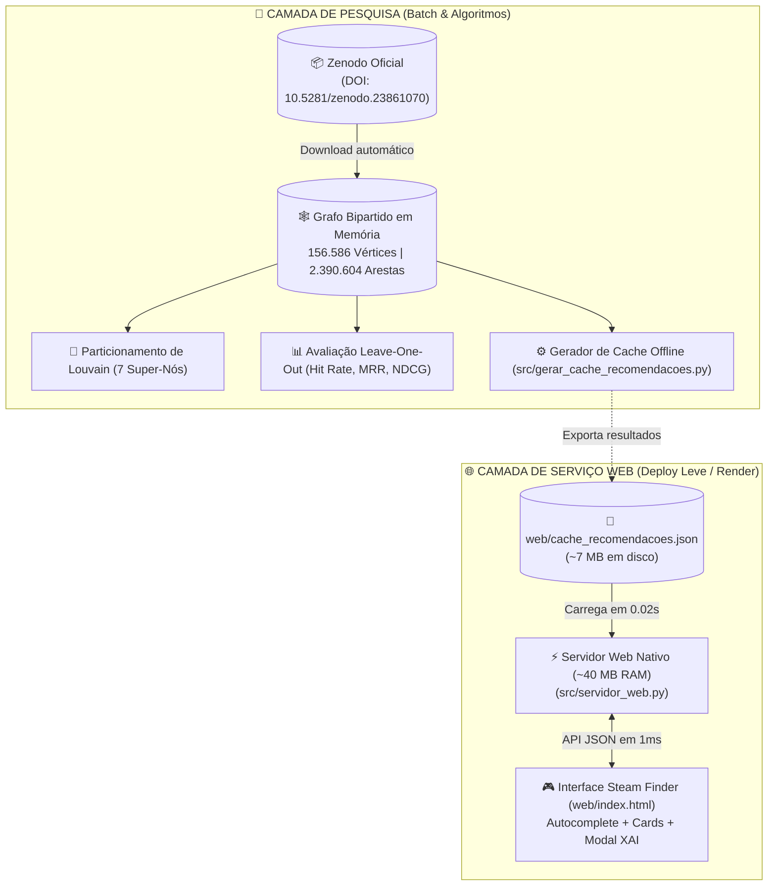
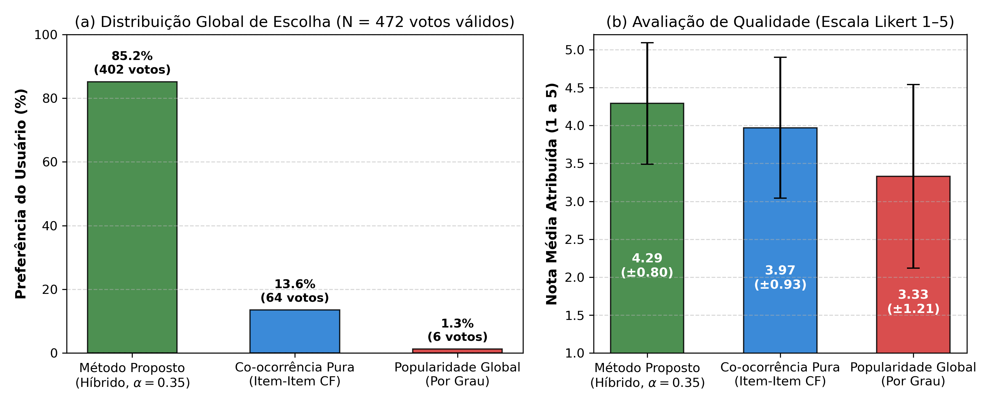

# 🎮 Steam Finder — Sistema Híbrido de Recomendação de Jogos baseado em Grafos

<div align="center">


**Trabalho Final da disciplina de Algoritmos e Estruturas de Dados II**  
*Centro Federal de Educação Tecnológica de Minas Gerais (CEFET-MG / UFCI-MG)*

**Autores:** [Rafael Alves Faria](https://github.com/rafa16w34) • [Gabriel Alves Faria](https://github.com/Gabriel12342)  
**Orientador:** [Prof. Michel Pires da Silva](https://github.com/mpiress)

</div>

---

## 📌 Sumário Executivo

O **Steam Finder** é um motor híbrido de recomendação e busca semântica para jogos digitais na plataforma Steam, construído estritamente sobre **fundamentos de Teoria dos Grafos** e **Algoritmos Avançados**. O sistema modela a interação entre mais de 150 mil usuários e o catálogo de jogos através de um **Grafo Bipartido Ponderado**, combinando:

1. **Filtragem Colaborativa Estrutural**: Busca em Largura (BFS) em 2 níveis sobre arestas com validação social $W(u,j)$;
2. **Modulação Comunitária (Louvain)**: Agrupamento em 7 Super-Nós temáticos para reforço de congruência de nicho;
3. **Consenso Semântico de Tags**: Índice de Jaccard Ponderado (Índice de Ruzicka) com decaimento exponencial de relevância e penalização $\text{IDF}^2$;
4. **Poda Prévia de Qualidade**: Exclusão estrutural de jogos com aprovação pública inferior a $65\%$;
5. **Atenuação Anti-Hub**: Penalização de títulos excessivamente populares via $1/\text{Grau}^{0.35}$;
6. **Explicabilidade Algorítmica (XAI)**: Interface web com discriminação visual detalhada de todos os fatores que compõem o score de recomendação.

---

## 🏛️ Arquitetura em Duas Camadas: Serviço Online vs. Pesquisa Científica

Para permitir que o projeto seja simultaneamente **auditável academicamente** e **leve para deploy gratuito em nuvem** (ex: [Render.com](https://render.com/)), o repositório é desenhado em duas camadas complementares:



| Aspecto | 🌐 Camada Online (Web / Render) | 🔬 Camada de Pesquisa (Artigo / Zenodo) |
| :--- | :--- | :--- |
| **Público-Alvo** | Avaliadores navegando no site, colegas, usuários finais | Professor, revisores do artigo, pesquisadores |
| **Ponto de Entrada** | `python3 src/servidor_web.py` ou link do Render | `python3 src/main.py` ou `src/avaliar_recomendador.py` |
| **Origem dos Dados** | `web/cache_recomendacoes.json` | Dataset bruto oficial no Zenodo (DOI: 10.5281/zenodo.23861070) |
| **Consumo de Memória** | **~40 MB de RAM** (compatível com teto de 512 MB do Render) | **~1.18 GB de RAM** (grafo completo em memória) |
| **Latência de Resposta** | **~1 ms** (acesso indexado O(1)) | **~150 ms** (traversal BFS em 2.4M arestas) |
| **Objetivo** | Alta disponibilidade, rapidez e experiência interativa | Reprodutibilidade científica, auditoria e métricas formais |

---

## 🚀 Guia Rápido de Execução

Clone o repositório em sua máquina local:
```bash
git clone https://github.com/rafa16w34/TrabalhoFinal-AEDS2.git
cd TrabalhoFinal-AEDS2
```

### Caso 1: Testar a Interface Web (Modo Rápido / Nuvem Leve)
Para subir o servidor web local consumindo apenas **40 MB de RAM** com inicialização instantânea:
```bash
python3 src/servidor_web.py
```
> O servidor abrirá automaticamente em seu navegador padrão no endereço: `http://localhost:5000`.

---

### Caso 2: Reproduzir os Experimentos Científicos do Artigo (Zenodo)
Para rodar a pesquisa formal a partir do zero utilizando os dados brutos:

```bash
# 1. Menu Interativo de Pesquisa (Jogos de Teste do Artigo, Comunidades Louvain e Grafo)
python3 src/main.py

# 2. Avaliação Formal Leave-One-Out (Hit Rate@10, MRR e NDCG citados no artigo)
python3 src/avaliar_recomendador.py

# 3. Processamento em Lote com arquivo de entrada (input/jogos_entrada.txt)
python3 src/recomendar_lote.py

# 4. Rodar o Servidor Web calculando ao vivo no grafo de 2.4M arestas (ignora o cache)
python3 src/servidor_web.py --dinamico

# 5. Reproduzir Métricas do Artigo Científico (Modularidade Louvain Q=0.3077 e Baselines)
python3 src/reproduzir_tabelas.py
```

> [!NOTE]
> **Reprodutibilidade Científica Automatizada**: Se você acabou de clonar o repositório e a pasta `extracted_data/` não existir, os scripts acima realizam o **download e extração automática dos 37 MB** compactados diretamente do registro oficial do **Zenodo (DOI: 10.5281/zenodo.23861070)** com barra de progresso. Nenhuma intervenção manual é necessária.

---

### Caso 3: Recalcular o Cache Completo para a Nuvem
Se você realizou alterações nos pesos do algoritmo em `src/recommender.py` e deseja regerar o arquivo `web/cache_recomendacoes.json`:
```bash
python3 src/gerar_cache_recomendacoes.py
```
O script utiliza paralelismo por threads (`ThreadPoolExecutor`) e processa todos os 3.573 jogos em poucos minutos com estimativa de tempo (ETA).

---

## 📐 Fundamentos Teóricos e Formulação Matemática

### 1. Poda Prévia Baseada em Qualidade
Antes da alocação de memória no grafo, jogos com aprovação pública inferior a $65\%$ são descartados:
$$\text{positive\_ratio}(j) \ge 65.0\%$$
Essa poda elimina **47.103 arestas espúrias** e reduz o consumo de RAM de 2.0 GB para **1.18 GB**, impedindo a propagação de títulos rejeitados pela comunidade (ex: *Artifact*). Ao consultar um jogo podado, o sistema apresenta tela informativa de justificativa algorítmica.

### 2. Validação Social das Conexões ($W(u,j)$)
Cada aresta entre o usuário $u$ e o jogo $j$ é ponderada pelo tempo de jogo e engajamento da crítica:
$$W(u, j) = \ln(1 + \text{horas}_{u,j}) \times \left[1 + 0.20 \cdot \ln(1 + \text{helpful}_{u,j})\right]$$

### 3. Detecção de Comunidades (Louvain)
O grafo é particionado pelo algoritmo de Louvain em **7 Super-Nós Semânticos** ($\text{seed}=16$, modularidade ótima):
* **Comunidade 0**: Indie & Roguelike 2D (Pixel Art, Metroidvania)
* **Comunidade 1**: Aventura Narrativa & Puzzle (Point & Click, Mistério)
* **Comunidade 2**: Estratégia & Simulação Tática (RTS, Wargame, 4X)
* **Comunidade 3**: FPS Clássico & Ação Retrô (Boomer Shooter, Retrô)
* **Comunidade 4**: JRPG & RPG Narrativo / Anime (Visual Novel, Ação Japonesa)
* **Comunidade 5**: Simulação, Direção & Mundo Aberto (Automobilismo, Corrida, VR)
* **Comunidade 6**: Expansões & Comunidades Emergentes

Jogos na mesma comunidade recebem impulso de $3.0\times$, preservando o nicho sem fechar a exploração.

### 4. Consenso Ponderado de Tags (Índice de Ruzicka com $\text{IDF}^2$)
A similaridade temática é calculada pelo Jaccard Generalizado com penalização para tags genéricas:
$$J_{\text{tags}}(A, B) = \frac{\sum_{t \in T_A \cap T_B} \min(w_{A,t}, w_{B,t})}{\sum_{t \in T_A \cup T_B} \max(w_{A,t}, w_{B,t})}, \quad \text{onde } w_{i,t} = e^{-0.05 \cdot \text{rank}(t)} \cdot \text{IDF}(t)^2$$
Apenas pares com $J_{\text{tags}} \ge 0.20$ recebem eventuais bônus de estúdio ($\beta_{\text{dev}} = +0.10$), eliminando contaminações cross-gênero da mesma publicadora (ex: *DMC5* recomendado para *Resident Evil*).

### 5. Atenuação de Popularidade (Anti-Hub)
Jogos hiper-populares são normalizados pelo grau no grafo para evitar recomendações triviais:
$$\text{Score}(j) = \text{Score}_{\text{bruto}}(j) \times \frac{1}{\text{Grau}(j)^{0.35}} \times \left(\frac{\text{positive\_ratio}(j)}{100}\right)$$

---

## 📊 Avaliação Cega com Usuários (Pesquisa de Campo)

O método proposto foi submetido a um teste cego online com **$R = 33$ participantes** avaliando **17 títulos representativos** da Steam ($M = 472$ julgamentos válidos). Em cada questão, 3 listas Top-5 anônimas foram comparadas com rotação determinística das opções:

| Método Avaliado | Escolhas ($M$) | Proporção (\%) | IC 95\% (Wilson) | Nota Média (1–5) |
| :--- | :---: | :---: | :---: | :---: |
| **Método Proposto ($\alpha=0{,}35$)** | **402** | **85,17\%** | **[81,7\%, 88,1\%]** | **4,29 ± 0,80** |
| **Co-ocorrência Pura (CF)** | 64 | 13,56\% | [10,8\%, 16,9\%] | 3,97 ± 0,93 |
| **Popularidade Global** | 6 | 1,27\% | [0,6\%, 2,7\%] | 3,33 ± 1,21 |

<p align="center">
  
</p>

* **Significância Estatística:** Teste qui-quadrado de aderência com $\chi^2 = 581{,}41$ ($p < 0{,}001$), teste binomial exato com $p < 10^{-119}$ e superioridade de satisfação confirmada via Mann-Whitney ($U = 15.316{,}5$, $p = 0{,}0031$).
* **Vitória por Título:** O método híbrido obteve a maioria das preferências em **100% dos jogos testados** (17 de 17 títulos).

---

## 📂 Estrutura do Repositório

```text
TrabalhoFinal-AEDS2/
├── README.md                           # Documentação central do projeto
├── input/
│   └── jogos_entrada.txt               # Catálogo de jogos para processamento em lote
├── output/
│   ├── comunidades_louvain.json        # Cache determinístico das 7 partições do Louvain
│   ├── relatorio_recomendacoes_lote.txt# Relatório textual com recomendações em lote
│   ├── metricas_multidimensionais.json # Métricas de catálogo, acurácia e cobertura
│   └── universo_super_nos.gexf         # Exportação da topologia de Super-Nós para o Gephi
├── pesquisa_campo/
│   ├── respostas_formulario.csv        # Respostas brutas da avaliação cega (R=33, M=472)
│   ├── pesquisa_campo_geral.png        # Gráfico estatístico geral com intervalos de confiança
│   └── pesquisa_campo_por_jogo.png     # Detalhamento de vitória e satisfação por jogo
├── src/
│   ├── main.py                         # Ponto de entrada do modo pesquisa (menu interativo)
│   ├── recommender.py                  # Motor central de grafos, BFS em 2 níveis e escore híbrido
│   ├── reproduzir_tabelas.py           # Reprodutibilidade instantânea das métricas do artigo
│   ├── avaliar_recomendador.py         # Módulo de avaliação Leave-One-Out (Hit Rate, MRR, NDCG)
│   ├── avaliar_metricas_multidimensionais.py # Avaliação de sobreposição de gêneros e cobertura
│   ├── servidor_web.py                 # Servidor HTTP nativo (atende localhost e nuvem Render)
│   ├── gerar_cache_recomendacoes.py    # Gerador multithread do cache pré-calculado
│   ├── recomendar_lote.py              # Script de processamento em lote
│   └── export_to_gephi.py              # Utilitário de exportação para visualização em rede
└── web/
    ├── index.html                      # Interface visual moderna (Steam Theme, XAI Modal)
    ├── logo.png                        # Identidade visual oficial
    └── cache_recomendacoes.json        # Banco indexado para deploy em nuvem (~40 MB RAM)
```


## 📜 Citação Acadêmica e Dados

Para citar este projeto ou o dataset em trabalhos acadêmicos:

```bibtex
@dataset{faria2024steamgraph,
  author       = {Rafael Alves Faria and Gabriel Alves Faria},
  title        = {Steam Graph Dataset: Bipartite Interaction Graph and Semantic Game Metadata},
  month        = nov,
  year         = 2026,
  publisher    = {Zenodo},
  doi          = {10.5281/zenodo.23861070},
  url          = {https://doi.org/10.5281/zenodo.23861070}
}
```

---

<div align="center">
Desenvolvido com dedicação para a disciplina de <b>Algoritmos e Estruturas de Dados II</b> • <b>CEFET-MG / UFCI-MG</b>
</div>


## Autores

<table>
<tr>
           <th>
 
           </th>
           <th>
 
           </th>

</tr>
  <tr>
           <td>
                      <sub><a href="https://www.linkedin.com/in/rafael-alves-faria-0a4028359/">Rafael Alves Faria</a></sub>
           </td>
           <td>
                      <sub><a href="https://www.linkedin.com/in/gabriel-alves-443132207/">Gabriel Alves Faria</a></sub>    
           </td>

  </tr>
</table>

