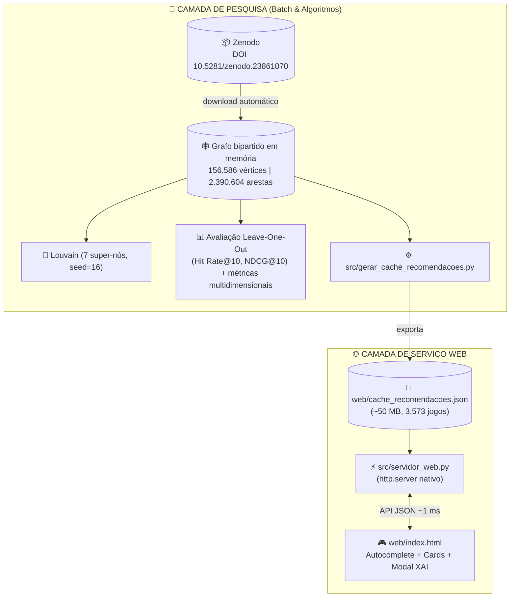
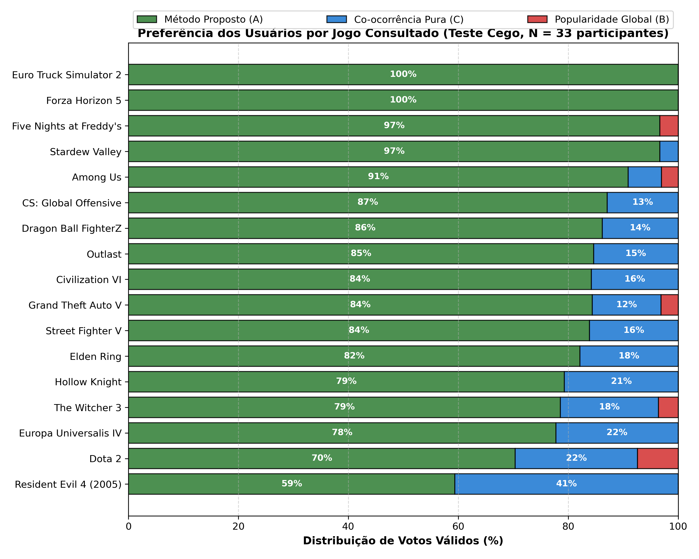

# 🎮 Steam Finder — Sistema Híbrido de Recomendação de Jogos baseado em Grafos

<div align="center">


**Trabalho Final da disciplina de Algoritmos e Estruturas de Dados II**
*Centro Federal de Educação Tecnológica de Minas Gerais (CEFET-MG / UFCI-MG) — Campus V, Divinópolis*

**Autores:** [Rafael Alves Faria](https://github.com/rafa16w34) • [Gabriel Alves Faria](https://github.com/Gabriel12342)  
**Orientador:** [Prof. Michel Pires da Silva](https://github.com/mpiress)

🌐 **[Demo online](https://steam-finder.onrender.com)** • 📄 **[Artigo (PDF)](Artigo_Trabalho_Final__AEDS_2__Rafael_Gabriel.pdf)** • 📦 **[Dataset no Zenodo](https://doi.org/10.5281/zenodo.23861070)**

</div>

---

## 📌 Sumário

O **Steam Finder** é um recomendador item-a-item de jogos da Steam construído sobre **Teoria dos Grafos** e **estruturas de dados clássicas** (grafo bipartido, tabelas hash, BFS). A rede de interações entre **153.013 usuários** e **3.573 jogos** (**2.390.604 arestas**) é modelada como um **grafo bipartido ponderado**, e o score de cada recomendação combina:

1. **Filtragem colaborativa estrutural** — BFS em 2 níveis (jogo → usuários → jogos), com a vizinhança limitada aos `K = 1000` usuários mais engajados;
2. **Comunidades de Louvain** — 7 super-nós temáticos, com bônus ×3,0 para candidatos da mesma comunidade;
3. **Similaridade de tags** — Índice de Jaccard Ponderado (Ruzicka) com `IDF²` e decaimento por posição da tag, usado também como corte semântico (`J ≥ 0,20`);
4. **Poda de qualidade** — jogos com aprovação pública `< 65%` não entram no grafo;
5. **Filtro de dissonância de tom** — impede que títulos *mature* recomendem títulos *family friendly* (e vice-versa);
6. **Amortecimento de hubs** — o score é dividido por `Grau(j)^0,35`;
7. **Explicabilidade (XAI)** — a interface web mostra cada fator que compõe o score.

> **Resultado em uma frase:** o método não supera a co-ocorrência pura em *Hit Rate* bruto, mas entrega recomendações **mais coerentes tematicamente, com maior cobertura do catálogo e menor viés de popularidade**, e foi preferido em **85,2%** das escolhas num teste cego com usuários. Detalhes e limitações na seção [Resultados](#-resultados).

---

## 🏛️ Arquitetura em duas camadas

O repositório separa o **serviço web** (leve, usa um cache pré-calculado) da **camada de pesquisa** (calcula tudo ao vivo sobre o grafo completo, para reprodutibilidade).



| Aspecto | 🌐 Camada Web (cache) | 🔬 Camada de Pesquisa (grafo completo) |
| :--- | :--- | :--- |
| **Público-alvo** | Quem quer apenas usar/avaliar o site | Professor, revisores, pesquisadores |
| **Ponto de entrada** | `python3 src/servidor_web.py` | `python3 src/main.py`, `src/avaliar_recomendador.py` etc. |
| **Origem dos dados** | `web/cache_recomendacoes.json` | Dataset bruto no Zenodo (baixado automaticamente) |
| **Memória (RAM)** | ≈ 250 MB medidos em cache mode (cabe nos 512 MB do plano free do Render) | ≈ 1,2 GB (pico medido de 1.211 MB no artigo) |
| **Latência por consulta** | ≈ 1 ms (lookup indexado) | mediana ≈ 474 ms (P95 ≈ 740 ms) |
| **Objetivo** | Disponibilidade e experiência interativa | Reprodutibilidade científica e métricas formais |

---

## 🚀 Como executar

Python é interpretado, então **não há etapa de compilação**: basta instalar as dependências e executar os scripts. Os comandos abaixo valem para Linux/macOS; no Windows use `python` no lugar de `python3`.

### 1. Preparar o ambiente
```bash
git clone https://github.com/rafa16w34/TrabalhoFinal-AEDS2.git
cd TrabalhoFinal-AEDS2
python3 -m venv venv
source venv/bin/activate          # Windows: venv\Scripts\activate
pip install -r requirements.txt   # networkx, requests
```

| Requisito | Para a interface web (cache) | Para os experimentos (grafo completo) |
| :--- | :---: | :---: |
| Python | 3.10+ | 3.10+ |
| RAM livre | ≈ 250 MB | ≈ 2 GB (o grafo ocupa ≈ 1,2 GB) |
| Internet | Sim (Recomendado) | sim, na 1ª execução (download de ≈ 37 MB) e para melhor visualização das imagens |

### 2. Verificação rápida — interface web (usa o cache)
```bash
python3 src/servidor_web.py
```
O servidor sobe em `http://localhost:5000` e abre o navegador automaticamente, sem baixar dados (usa o `web/cache_recomendacoes.json` do repositório). Busque, por exemplo, *ELDEN RING* e clique em um card para abrir o modal de explicabilidade (XAI). A mesma interface está publicada em <https://steam-finder.onrender.com>.

Para escolher a porta, use `python3 src/servidor_web.py 8080` (ou a variável `PORT`); nesses casos o navegador não abre sozinho.

### 3. Reproduzir os experimentos do artigo (grafo completo)

> [!NOTE]
> **Download automático dos dados.** Se a pasta `extracted_data/` não existir, qualquer comando abaixo baixa e extrai o dataset (≈ 37 MB compactado) do Zenodo — [DOI 10.5281/zenodo.23861070](https://doi.org/10.5281/zenodo.23861070) — com barra de progresso. Nenhuma intervenção manual é necessária.

| Ordem | Comando | O que demonstra | Seção do artigo |
| :-: | :--- | :--- | :--- |
| 1 | `python3 src/main.py` | Constrói o grafo (156.586 vértices, 2.390.604 arestas), roda o Louvain e abre o menu de consultas | Metodologia |
| 2 | `python3 src/reproduzir_tabelas.py` | Baselines em 5 sementes, modularidade **Q = 0,3077** e latência por faixa de grau (`--tabela1` roda só os baselines) | Resultados |
| 3 | `python3 src/avaliar_recomendador.py` | Protocolo Leave-One-Out: Hit Rate@10 e NDCG@10 | Resultados |
| 4 | `python3 src/avaliar_metricas_multidimensionais.py` | Sobreposição de gêneros, cobertura do catálogo e grau médio | Resultados |
| 5 | `python3 src/recomendar_lote.py [entrada] [saída]` | Recomendações em lote (padrão: lê `input/jogos_entrada.txt` e grava `output/relatorio_recomendacoes_lote.txt`) | — |
| 6 | `python3 src/servidor_web.py --dinamico` | Interface web calculando ao vivo no grafo, sem cache | — |

As sementes fixas (`seed = 16` no Louvain e `seed = 42…46` na avaliação) garantem a repetibilidade dos resultados. Os tempos de execução variam conforme o hardware.

### 4. Opcional: regenerar o cache e refazer o pré-processamento
```bash
# Regenera web/cache_recomendacoes.json após alterar pesos em src/recommender.py
python3 src/gerar_cache_recomendacoes.py        # todos os 3.573 jogos
python3 src/gerar_cache_recomendacoes.py 100    # apenas os 100 primeiros (teste rápido)

# Reconstrói a base do zero (o resultado já está publicado no Zenodo)
python3 src/extrair_dados.py                    # poda por mediana adaptativa + k-core
python3 src/enriquecer_metadados_steamspy.py    # tags e gêneros via SteamSpy API
```
O gerador de cache usa `ThreadPoolExecutor` e grava as Top-10 recomendações e o diagnóstico XAI de cada jogo.

### 5. Problemas comuns
* **`ModuleNotFoundError: networkx`** → o ambiente virtual não está ativo ou faltou `pip install -r requirements.txt`.
* **Falha no download do Zenodo** → baixe `Data-Steam.zip` manualmente em <https://doi.org/10.5281/zenodo.23861070> e extraia o conteúdo em `extracted_data/`, na raiz do projeto.
* **Porta 5000 ocupada** → `python3 src/servidor_web.py 8080`.
* **Memória insuficiente** → use apenas o passo 2, que consome ≈ 250 MB.

---

## 🔌 API HTTP

O servidor expõe os endpoints usados pela interface:

| Método | Rota | Descrição |
| :---: | :--- | :--- |
| `GET` | `/api/jogos` | Lista de jogos para o autocomplete (id, nome, comunidade, aprovação, gêneros) |
| `GET` | `/api/comunidades` | Rótulos dos 7 super-nós |
| `GET` | `/api/recomendar?id=<app_id>` | Top-10 recomendações + diagnóstico XAI |
| `GET` | `/api/relatorio_lote` | Relatório de recomendações em lote |
| `POST` | `/api/lote` | Processa uma lista de jogos em lote |
| `POST` | `/api/gephi` | Gera os arquivos de exportação para o Gephi |

---

## 📐 Fundamentos teóricos e formulação

### 1. Construção do grafo
Partindo da base pública da Steam (≈ 41 milhões de avaliações, ≈ 40 mil jogos), o pré-processamento mantém apenas **avaliações positivas** e aplica: (i) poda por **mediana adaptativa de horas jogadas** por jogo; (ii) **decomposição k-core assimétrica** com `(kU, kV) = (10, 50)`; e (iii) descarte de jogos sem tags. O grafo resultante é `G = (U ∪ V, E, W)`, não-direcionado e ponderado, armazenado em dicionários (tabelas hash) com acesso esperado O(1).

### 2. Poda prévia de qualidade
Jogos com aprovação pública abaixo de 65% são excluídos antes da construção do grafo:
$$\text{positive\_ratio}(j) \ge 65{,}0\%$$
Isso evita que títulos rejeitados pela comunidade (ex.: *Artifact*) propaguem recomendações. Ao consultar um jogo podado, a interface exibe uma tela explicando o motivo.

### 3. Peso das arestas (validação social)
$$W(u, j) = \ln(1 + \text{horas}_{u,j}) \times \left[1 + 0{,}20 \cdot \ln(1 + \text{helpful}_{u,j})\right]$$
O `ln` amortece usuários com milhares de horas; o termo `helpful` pondera pela credibilidade da avaliação.

### 4. Detecção de comunidades (Louvain)
O grafo é particionado pelo algoritmo de Louvain (`seed = 16`, modularidade **Q = 0,3077**) em **7 super-nós**:

| ID | Nome (rótulo da interface) | Tema | Jogos | Exemplos |
| :-: | :--- | :--- | :-: | :--- |
| 0 | Action / Co-op | FPS, cooperativo, multiplayer, clássicos | 543 | Team Fortress 2, DOOM, Portal 2, Garry's Mod |
| 1 | Indie / Roguelike | Roguelike, pixel art, metroidvania | 996 | The Binding of Isaac, Hades, Stardew Valley |
| 2 | Simulation | Automobilismo, caminhões, caça, simulação realista | 100 | Euro Truck Simulator 2, theHunter |
| 3 | Strategy / CMS | Construção de base, grande estratégia, sobrevivência | 652 | Fallout 4, No Man's Sky, RimWorld, Factorio |
| 4 | Action / Narrative | Ação em 3ª pessoa, narrativa, stealth | 616 | Fallout: New Vegas, Borderlands 2, Tomb Raider |
| 5 | Action RPG / AAA | RPG de ação, mundo aberto, souls-like | 396 | The Witcher 3, DARK SOULS III, Cyberpunk 2077 |
| 6 | JRPG / Competitive | JRPG, anime, luta competitiva, MOBA | 270 | Yakuza 0, Dota 2, Persona 4, TEKKEN 7 |

A atribuição completa (usuários e jogos) está em `output/comunidades_louvain.json`, e a topologia pode ser aberta no Gephi (`output/universo_super_nos.gexf`).

### 5. Similaridade de tags (Ruzicka com IDF²)
Cada jogo tem até 20 tags da comunidade (SteamSpy), ordenadas por consenso. O peso da tag `t` de posição `r` entre `n` tags é:
$$w_{i,t} = \text{IDF}(t)^2 \cdot \left(1 - 0{,}70 \cdot \frac{r}{n-1}\right), \qquad \text{IDF}(t) = \ln\frac{1+N}{1+\text{df}(t)} + 1$$

(a 1ª tag mantém 100% do peso; a 20ª, 30%). A similaridade é o Jaccard generalizado:

$$J_{\text{tags}}(A, B) = \frac{\sum_{t \in T_A \cap T_B} \min(w_{A,t}, w_{B,t})}{\sum_{t \in T_A \cup T_B} \max(w_{A,t}, w_{B,t})}$$

Candidatos com `J_tags < 0,20` são descartados. Só os que passam recebem o bônus de estúdio (`β_dev = +0,10`), o que evita contaminação cross-gênero da mesma publicadora (ex.: *DMC5* recomendado para *Resident Evil*).

### 6. Fatores multiplicativos auxiliares
* **Gênero oficial** (`β_gen`): ×1,15 se os jogos compartilham ao menos um gênero; ×0,65 se não compartilham nenhum.
* **Comunidade** (`β_com`): ×3,0 se alvo e candidato estão no mesmo super-nó.
* **Dissonância de tom**: candidatos *mature* (ex.: `violent`, `gore`, `nudity`) são excluídos para alvos *family friendly* e vice-versa.
* **Qualidade**: multiplicação por `p(v)/100`, onde `p(v)` é a aprovação pública do candidato.

### 7. Score final e amortecimento de hubs
Para o jogo-alvo `a`, cada caminho `a → u → v` (com `u` entre os `K = 1000` usuários de maior `W(u,a)`) contribui com:

$$s(u,v) = W(u,a)\cdot W(u,v)\cdot \beta_{com}\cdot \beta_{gen}\cdot \left(J_{\text{tags}} + \beta_{dev} + 0{,}1\right)\cdot \frac{p(v)}{100}$$

Os caminhos convergentes são somados e o total é amortecido pelo grau do candidato:
$$\text{Score}(v) = \frac{\sum_{u} s(u,v)}{\text{Grau}(v)^{0{,}35}}$$

### Parâmetros do método

| Parâmetro | Símbolo | Valor |
| :--- | :---: | :---: |
| Grau mínimo k-core (usuário, item) | `(kU, kV)` | (10, 50) |
| Aprovação mínima | — | 65% |
| Vizinhança da BFS (nível 1) | `K` | 1000 usuários |
| Peso do `helpful` | — | 0,20 |
| Corte de similaridade de tags | `τ_J` | 0,20 |
| Bônus de comunidade | `β_com` | 3,0 |
| Bônus de estúdio | `β_dev` | 0,10 |
| Bônus / penalidade de gênero | `β_gen` | 1,15 / 0,65 |
| Expoente de amortecimento | `α` | 0,35 |
| Semente do Louvain | `seed` | 16 |

---

## 📊 Resultados

Todos os números abaixo vêm do [artigo](Artigo_Trabalho_Final__AEDS_2__Rafael_Gabriel.pdf) e podem ser reproduzidos com os scripts da [Opção 2](#opção-2--reproduzir-os-experimentos-do-artigo).

### Acurácia (Leave-One-Out, 5 partições, N = 300, K = 1000)

| Modelo | Hit Rate@10 | NDCG@10 |
| :--- | :---: | :---: |
| Aleatório (50 simulações) | 0,26% | 0,0012 |
| Popularidade global | 5,47% ± 1,15% | 0,0268 ± 0,0064 |
| Co-ocorrência pura (CF) | 8,80% ± 1,50% | 0,0425 ± 0,0092 |
| **Método proposto (α = 0,35)** | **4,93% ± 1,04%** | 0,0244 (partição de referência) |

O método **não** supera a co-ocorrência pura na recuperação de um item oculto — resultado esperado, já que 94,0% dos itens de teste estão acima da mediana de popularidade do catálogo, e o método foi desenhado para *moderar* esse viés.

### Coerência, cobertura e popularidade (partição de referência)

| Modelo | Sobreposição de gêneros | Cobertura do catálogo |
| :--- | :---: | :---: |
| Popularidade global | 26,8% | 10 jogos |
| Co-ocorrência pura | 39,2% | 257 jogos |
| Método sem amortecimento (α = 0) | 56,0% | 769 jogos |
| **Método proposto (α = 0,35)** | **57,0%** | **886 jogos** |

Além disso, o amortecimento reduz o grau médio dos itens recomendados em **14,7%** (e a mediana em 18,1%) em relação ao modelo sem amortecimento. As métricas por modelo estão em `output/metricas_multidimensionais.json`.

### Avaliação cega com usuários

Teste online com **R = 33 participantes** e **17 jogos** (**M = 472 julgamentos válidos**). Em cada questão, 3 listas Top-5 anônimas eram comparadas, com a ordem das opções rotacionada de forma determinística.

| Método avaliado | Escolhas | Proporção | IC 95% (Wilson) | Nota média (1–5) |
| :--- | :---: | :---: | :---: | :---: |
| **Método proposto (α = 0,35)** | **402** | **85,17%** | **[81,7%; 88,1%]** | **4,29 ± 0,80** |
| Co-ocorrência pura (CF) | 64 | 13,56% | [10,8%; 16,9%] | 3,97 ± 0,93 |
| Popularidade global | 6 | 1,27% | [0,6%; 2,7%] | 3,33 ± 1,21 |

<p align="center">
  
</p>

* **Significância:** qui-quadrado de aderência `χ² = 581,41` (`p < 0,001`); teste binomial exato `p < 10⁻¹¹⁹`; Mann-Whitney `U = 15.316,5` (`p = 0,0031`) para a satisfação.
* **Vitória por título:** o método proposto foi o mais escolhido nos **17 de 17** jogos. Respostas brutas em `pesquisa_campo/respostas_formulario.csv`.

<p align="center">
  
</p>

### Escala e latência (consulta com o grafo completo)

100 consultas amostradas, `K = 1000`, `α = 0,35`:

| Grau do jogo-alvo | Consultas | Arestas visitadas (nível 2, média) | Latência mediana | P95 |
| :--- | :---: | :---: | :---: | :---: |
| < 500 (nicho) | 13 | 4.738 | 108,6 ms | 259,0 ms |
| 500 a 2.000 | 14 | 17.346 | 349,7 ms | 591,6 ms |
| > 2.000 (hubs) | 73 | 21.863 | 492,4 ms | 733,2 ms |
| **Global** | 100 | 19.004 | **473,8 ms** | 739,6 ms |

A trava `K = 1000` estabiliza o custo nos hubs: a latência é aproximadamente proporcional ao número de arestas visitadas (≈ 0,02 ms por aresta). Com o cache, a consulta cai para ≈ 1 ms.

### Limitações (conforme o artigo)
* Hiperparâmetros calibrados na mesma partição que integra o conjunto de teste (`seed = 42`);
* Amostra de 300 usuários com baixo poder estatístico para itens de cauda longa;
* *Cold-start* para jogos excluídos pelo k-core;
* Pesquisa de campo com amostra de conveniência (33 participantes).

---

## 📂 Estrutura do repositório

```text
TrabalhoFinal-AEDS2/
├── README.md
├── requirements.txt                    # networkx, requests
├── Artigo_Trabalho_Final__AEDS_2__Rafael_Gabriel.pdf   # Artigo científico
├── input/
│   └── jogos_entrada.txt               # App IDs para processamento em lote
├── output/
│   ├── comunidades_louvain.json        # Partição Louvain (usuário/jogo → super-nó)
│   ├── metricas_multidimensionais.json # Hit Rate, NDCG, coerência, cobertura por modelo
│   ├── relatorio_recomendacoes_lote.txt# Recomendações em lote
│   ├── universo_super_nos.gexf         # Topologia dos 7 super-nós (Gephi)
│   └── universo_steam_hibrido.gexf     # Backbone dos 3.573 jogos (Gephi)
├── pesquisa_campo/
│   ├── respostas_formulario.csv        # Respostas brutas (R=33, M=472)
│   ├── pesquisa_campo_geral.png
│   └── pesquisa_campo_por_jogo.png
├── src/
│   ├── main.py                         # Menu interativo de pesquisa + inicialização do grafo
│   ├── recommender.py                  # Grafo, BFS em 2 níveis, similaridade e score híbrido
│   ├── extrair_dados.py                # Pré-processamento: mediana adaptativa + k-core
│   ├── enriquecer_metadados_steamspy.py# Tags e gêneros via SteamSpy
│   ├── avaliar_recomendador.py         # Leave-One-Out (Hit Rate@10, NDCG@10)
│   ├── avaliar_metricas_multidimensionais.py # Coerência de gêneros/tags e cobertura
│   ├── reproduzir_tabelas.py           # Tabelas do artigo (baselines, Q, latência)
│   ├── recomendar_lote.py              # Processamento em lote
│   ├── gerar_cache_recomendacoes.py    # Gerador multithread do cache
│   ├── servidor_web.py                 # Servidor HTTP nativo (local e Render)
│   └── export_to_gephi.py              # Exportação para o Gephi
└── web/
    ├── index.html                      # Interface (tema Steam, modal XAI)
    ├── logo.png
    └── cache_recomendacoes.json        # Cache pré-calculado (~50 MB)
```

---

## 📜 Citação

```bibtex
@dataset{faria2026steamgraph,
  author    = {Rafael Alves Faria and Gabriel Alves Faria},
  title     = {Steam Graph Dataset: Bipartite Interaction Graph and Semantic Game Metadata},
  year      = {2026},
  publisher = {Zenodo},
  doi       = {10.5281/zenodo.23861070},
  url       = {https://doi.org/10.5281/zenodo.23861070}
}
```

---

<div align="center">
Desenvolvido para a disciplina de <b>Algoritmos e Estruturas de Dados II</b> • <b>CEFET-MG / UFCI-MG</b>
</div>


## Autores

<table>
<tr>
           <th>

           </th>
           <th>

           </th>
</tr>
  <tr>
           <td>
                      <sub><a href="https://www.linkedin.com/in/rafael-alves-faria-0a4028359/">Rafael Alves Faria</a></sub>
           </td>
           <td>
                      <sub><a href="https://www.linkedin.com/in/gabriel-alves-443132207/">Gabriel Alves Faria</a></sub>
           </td>
  </tr>
</table>
